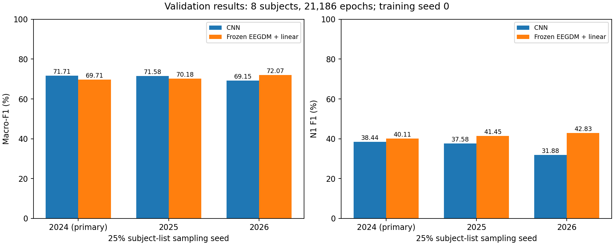
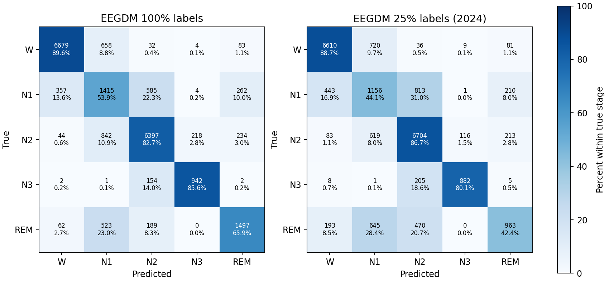

# 实验③第一周最终复盘与完成清单

记录日期：2026-10-23。负责人：C。范围：冻结EEGDM的EEG表征迁移及100%/25%线性分类，不包含D的EOG迁移与融合。

## 完成验收

| 原任务要求 | 当前证据 | 状态 |
|---|---|---|
| 环境、权重、随机前向 | environment；backbone_source.md；reports/backbone_verification.json | 完成 |
| 一页模型理解笔记 | 本目录EEGDM理解笔记.md | 完成 |
| 转换脚本、输入设置 | scripts/extract_features.py；configs/feature_config.yaml | 完成 |
| 几百段、三条件、两长度 | feature_pilot；本目录adapter_checks.json、channel_pilot_comparison.csv、length_comparison.csv | 完成（候选效果仅小样本） |
| 全量特征与资源/省空间方案 | features/eeg_cond14_v01；本目录resource_summary.json | 完成 |
| 相同名单100%/25%线性分类及CNN对比 | b_followup_20261023；三份B名单，训练seed0；统一评估与重放核验通过 | 完成 |
| 每次运行完整六件套 | 五个run均有README.md、config.yaml、history.csv、best.ckpt、metrics.json、predictions_val.csv | 完成 |
| 1–2个表征假设与复盘 | 见下文 | 完成 |
| D交接材料 | 原20261020全量包＋桌面20261023最终补充包（生成后见交付校验） | 本地整理完成，发送/接收需由本人确认 |

## 结果与现象

100% EEGDM主方案Macro-F1=74.97%，CNN=76.45%。25%三份名单EEGDM为69.71%、70.18%、72.07%，CNN为71.71%、71.58%、69.15%。均值70.66% vs 70.81%，整体接近，不能认定稳定整体优势。EEGDM的N1 F1三组均更高（40.11/41.45/42.83% vs 38.44/37.58/31.88%）。

主名单EEGDM从100%到25%：Macro-F1下降5.25个百分点，N1-F1从46.68%降至40.11%，REM-F1从68.84%降至51.46%。REM是值得优先检查的薄弱环节，但这不直接证明原因。

## 输入适配核对

全部296段、三个条件均核对30秒原生调用和显式六段调用；两者当前实质相同。不能将其作为连续30秒上下文与5秒上下文的科学性能对照。

| 条件 | 六人留一人试验的合并OOF Macro-F1 |
|---|---:|
| 14 | 70.59% |
| 18 | 69.43% |
| 10 | 70.34% |

这一小样本检查中得分最高的是条件14。只用原训练集六名受试者、296段、类别平衡抽样，StandardScaler与LogisticRegression均在每折训练部分拟合。这是补充性描述，不使用验证集或测试集，也不能证明全量最优；正式条件14不回溯更改。

## 两个待验证的表征假设

**假设1：冻结EEGDM对N1具有可用的迁移信息，但当前代理条件与简单线性头对REM分离不足。** 证据：三份25%名单N1-F1均高于CNN，主名单REM下降较大。下一阶段可在训练集内部按受试者嵌套交叉验证比较条件与正则化，并以N1/REM混淆为预设观察项；最终仅在独立数据上验证，不反复挑验证分数。当前证据不能归因于扩散目标或特定电极条件。

**假设2：简单保留全部时间位置会增大估计与优化难度，时间聚合和正则化可能更适合当前样本量。** 证据：时间展开头384005参数，均值头12805参数；同超参下Macro-F1=68.42% vs74.97%。下一阶段用训练集内部交叉验证调正则化、学习率，并比较5秒分块均值、1秒展开与等维度投影；控制参数量后再判断时间信息是否有益。当前不能声称时间信息无用，也不能仅凭训练曲线断言过拟合。

## 资源和省空间建议

122记录、154124段，特征23.67GB；记录级提取与写盘耗时合计1.40小时，峰值显存591.3MiB。该计时为各记录之和，不含初始化与记录间索引写入。

float16已实测相对L2误差约0.021%，相较float32约节省一半；只保留均值池化float32特征约1.58GB，但会丢失时间结构，D需要完整特征时不删除原始特征。5秒时间窗或选部分层可继续减小体积，尚未正式验证效果。

## 障碍、偏差及状态边界

已解决：WSL环境、S4回退、磁盘容量与B材料依赖。未安装S4自定义扩展。JSON/pt原文件已补导出为团队要求的YAML/CSV/ckpt标准命名；没有因此重训或改分。

原文档的PKL是官方输入约定，本机采用直接读取A的NPZ并调用官方提取器，实际张量转换与索引已检查，未为154124段各生成独立PKL。t=1与不加输入随机噪声的区别已在笔记中说明。通道14为预指定代理条件，未在全量三个条件中证明最优，不能将小样本排行说成全量最优。

只有一个固定训练种子，三份名单反映的波动与训练随机性不可完全分离；仅八位验证受试者，模型由验证集早停并比较。外部预训练数据重叠未审计。CNN与EEGDM架构、输入变换、优化器和设备不同。全部为第一周迁移可行性证据，测试集未使用。

本地实验、核验与交付文件已完成，并已通过feat/c-eegdm分支和PR #2发布。完整特征与权重仍由交付包提供。本次未代发文件给D、未代为上传网盘，也不声称D已接收。EOG、融合和全组N1错误分析由D负责，不列为C未完成实验。

## 复现与文件入口

运行索引：run_index.csv；环境与主干来源：../../environment、../../backbone_source.md；实际提取配置：../../configs/feature_config.yaml；25%流程：../../scripts/run_b_followup.py（已完成run会跳过训练并复核）；完整参数与单run命令在各runs/*/README.md。
