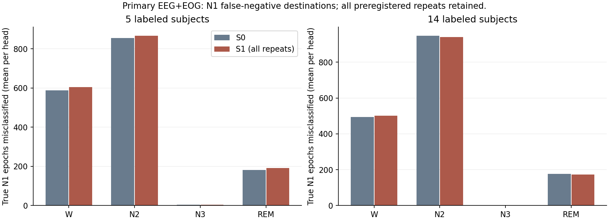
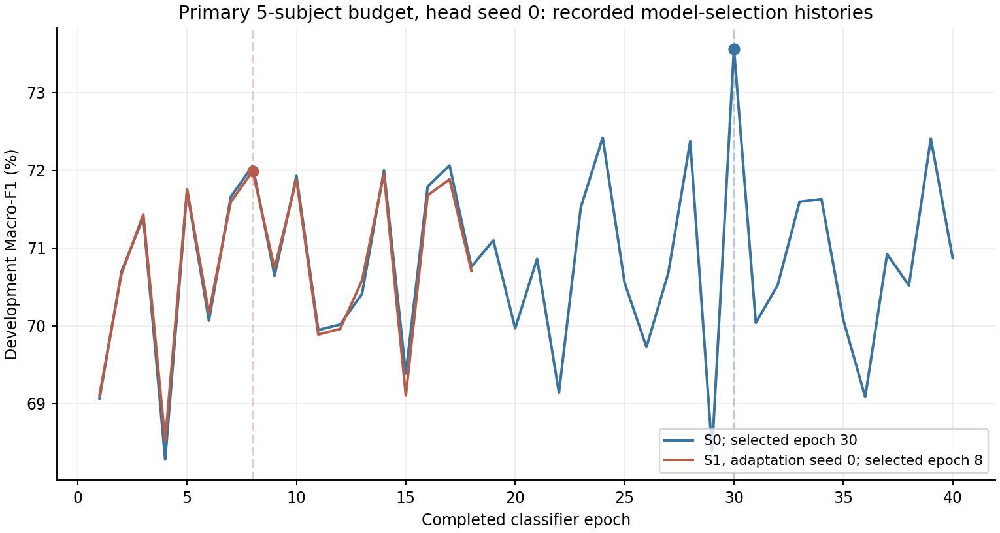

# N1错误分析与待检验假设

这是固定全部模型之后的事后诊断，不用于训练、标准化、选主干或重选分类头。60个S1−S0配对比较覆盖两种模态、两档预算、三份适配主干及五个下游种子。

## 可追溯输出

- [按人配对](per_subject_paired.csv)：每格8人的Macro-F1/N1差值、恢复/丢失/误报变化。
- [N1错向](n1_error_direction.csv)：真实N1被判为W/N2/N3/REM，以及各真实阶段被误报为N1，含计数和分母。
- [按上下文拆分](error_by_context.csv)：按同夜原始epoch_index相邻真标签，区分稳定、标签转换、缺口/夜晚边界；不跨剔除缺口或记录拼接。
- [全部变化记录](changed_N1_epochs.csv)：17284条模型对/epoch变化记录，样本可跨模型对重复，不能说成17284个独立个体或唯一epoch。
- [可复查实例](deterministic_case_examples.csv)：每个模态/预算/适配种子/变化方向取最小下游seed，再取最小sample_id，不按置信度或正向效果挑选。实例仅用于复查，不宣称生理代表性。

## 最差预定格的观察

模型对为 `W2_C_S0_EEG_EOG_label10_sseed2024_seed0_v01` 与 `W2_C_S1_EEG_EOG_aseed0_label10_sseed2024_seed0_v01`。Macro-F1差-1.574个百分点、N1 F1差-8.756个百分点、REM F1差-2.128个百分点。N1精确率基本相同，主要变化是召回下降。SC442和SC475的N1 F1下降分别约24.10和14.47个百分点，所有8人的明细均保留。

该格的N1变化按原始时序上下文拆分：

| 上下文 | 真实N1支持数 | 找回N1 | 丢失N1 |
| --- | ---: | ---: | ---: |
| gap_or_record_edge | 7 | 0 | 1 |
| label_transition | 1190 | 45 | 185 |
| stable_neighbors | 1426 | 55 | 300 |

上下文使用事后真标签注释，未进入模型；边界信息缺失时优先归入缺口/夜晚边界类别。不能从这些标签关系推断生理质量或病理机制。

B官方按8人聚类、1000次配对bootstrap给出该格N1差的95%区间约[-11.96,-6.53]个百分点，Macro-F1差约[-2.64,-0.65]个百分点；见[原始区间](../week2_fusion_20261029/execution/comparison_aseed0/paired_label10_seed0.json)。这是这一模型对的开发验证不确定性，不是全部设置的总体推断或独立测试证据。

## 待检验假设

1. **弱标注融合头的选模/优化轨迹可能放大微小表征变化。** 证据是最差格选中轮次30→8、同一patience规则下实际40→18轮，且N1预测数减少。关联不证明因果；如果下一轮要区分这种因素，须先登记固定更新预算的诊断方案，不能在本轮按验证成绩补训或更换结果。
2. **EEG-only的小幅变化在固定EOG加入后可能不能形成独立增益。** 依据是三轮10% EEG-only轻微正差，而主比较没有稳定正差。尚未证明是特征冗余、模态权重还是其他交互，不能把线性权重直接解释为因果重要性。
3. **继续扩散目标与N1目标可能不一致。** 主干梯度/参数更新通过且末层特征变化，但正式分期主比较未获稳定收益；现有观察不足确定是哪一种适配目标或可训练层选择更好。本周不因此扩展适配策略。

三项均为下一轮设计素材，未启动新的未经登记训练。当前结论保留全部三轮和正负方向。
