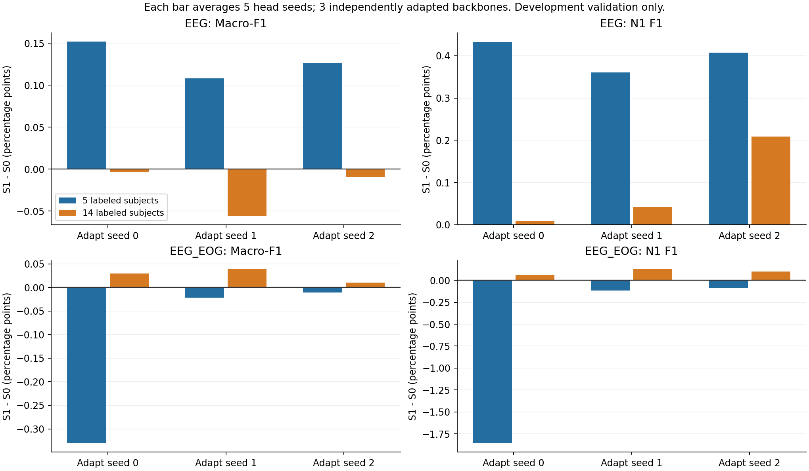

# 实验③第二周最终报告

2026-10-29。**预登记的3轮独立主干适配、40个EEG诊断分类头、40个EEG+EOG主对照分类头全部完成并核验。当前未证明稳定的双模态分期收益：10%预算平均退步，25%基本持平。**

> 完成状态补充：以上“全部完成”限定为C的本地实验计算和分析。B新版名单/协议确认、全组统一复评、D共同EOG基线来源认可及C本周正式GitHub/团队交付尚待闭环，见[A/B/D交接待办](A_B_D依赖与交接待办.md)。

## 主比较

以下均为8名开发验证者上的百分比。S0为5个下游种子均值；S1先按每个适配主干求5种子均值，再对3个主干等权平均。3×5个分类头不能当成15次独立主干适配或15份独立验证集。

| 标注预算 | 指标 | S0原始EEG+原始EOG | S1适配EEG+同一EOG | 差值（百分点） |
| --- | --- | ---: | ---: | ---: |
| 10%（5人） | Macro-F1 | 73.209% | 73.088% | -0.121 |
| 10%（5人） | N1 F1 | 38.454% | 37.764% | -0.689 |
| 10%（5人） | REM F1 | 70.338% | 70.377% | +0.040 |
| 25%（14人） | Macro-F1 | 74.558% | 74.584% | +0.026 |
| 25%（14人） | N1 F1 | 40.655% | 40.752% | +0.097 |
| 25%（14人） | REM F1 | 72.362% | 72.413% | +0.051 |

完整主干/预算/模态分表及头部标准差见 [adapt_comparison.csv](adapt_comparison.csv)，80个独立run见 [run_registry.csv](run_registry.csv)。原S0每种模态每预算仅5个头，跨适配比较时复用，未重复计为新的独立S0实验。EEG-only在10%下有很小的正差，但这是诊断，不能代替主比较。

## 完整性与公平比较

- 3份主干均从同一原始EMA开始，各10000次成功优化/新EMA更新，未继承梯度预检或测速权重；仅54人无标签训练EEG适配，验证和测试信号不参与适配。
- 固定step10000新EMA，不按开发验证N1或Macro-F1选主干；冻结前层/条件嵌入，20层gate及池化保持不变。
- 10%/25%分别是固定5/14人（11936/32310段），S0/S1各自只在当前有标签者拟合标准化；S1额外使用训练池54人的无标签信号，应与纯监督设置分开解释。
- 所有分类头采用相同优化/预算/严格Macro-F1早停规则，N1和REM均取自同一最佳头。80份归档SHA、checkpoint配置/维度/选模轮次、完整21186段预测元数据、官方点指标全部复核，见 [completion_audit.json](completion_audit.json)。
- 16名测试者一直封存。本地调用B官方v1完成复算，不代表B本人已接收或复核。

## N1错误分析结论

最明显退步位于适配seed0/下游seed0/10%双模态这一预定格。N1召回从40.64%降到25.92%，精确率约39.67%→39.79%；因此N1 F1从40.15%降到31.39%。总体准确率却从79.17%升到79.73%，说明不能仅以accuracy判断本课题N1目标。

该格找回100个原先漏检的N1，同时丢失486个原先正确的N1，净减少386个正确N1。N1→W净增237段、N1→N2净增152段；N1误报减少并不等于全部变为正确分期。所有方向均保留，未剔除此格或重新选头。

其选中轮次为S0第30轮、S1第8轮，实际分别训练40/18轮，符合相同patience10规则。不同选模轨迹与退步相伴，不能凭此断言早停是唯一原因，也没有据此延长训练或调参重跑。更详细的按人/错向/上下文分解见 [N1错误分析](N1错误分析与待检验假设.md)。

## EOG来源与结论边界

D完整EOG原文件未收到。本次用原始冻结EMA在本机按D的相同配置重建EOG，D的154124段索引和解析后的配置全部匹配；同一份本地EOG用于全部主比较。本地缓存已完整校验，但没有与未取得的D原始特征逐字节比较。来源变更单独记录于 [fusion_config.json](../week2_fusion_20261029/fusion_config.json)，原适配配置和锁未改写。

目前只有同一固定名单和8名开发验证者，不能宣称测试泛化、优于公平CNN或解决N1。三轮结果整体不支持“无标签扩散适配稳定改善少标签主比较”的结论。

## 交付入口

[交付索引与复现说明](交付索引与复现说明.md)列出配置、可训练参数、训练者/预算、3份历史、选定权重、5份特征索引、80份预测、资源与SHA。所有原始大缓存仍在原目录，报告目录包含索引而非完整复制。下一阶段的事后错误分析已完成；本周实验③预登记训练已齐，不追加未预登记种子或按分数挑选新策略。
