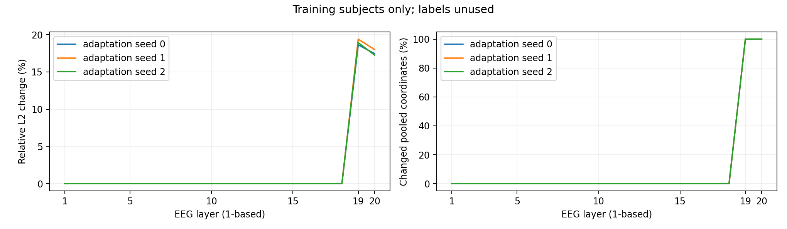

# EEG取层消融：完成报告

完成于 2026-10-31T18:09:46.368275+08:00。80个新头与40个all20参考共120格已核验。

| EEG层组 | 预算 | 表征 | Macro-F1 | N1 F1 |
| --- | --- | --- | ---: | ---: |
| all20 | label10 | S0 | 70.622% | 28.662% |
| all20 | label10 | S1 | 70.559% | 28.386% |
| all20 | label25 | S0 | 72.136% | 36.153% |
| all20 | label25 | S1 | 72.103% | 36.215% |
| last5 | label10 | S0 | 70.987% | 30.104% |
| last5 | label10 | S1 | 70.826% | 29.670% |
| last5 | label25 | S0 | 73.017% | 36.829% |
| last5 | label25 | S1 | 72.956% | 36.777% |
| last2 | label10 | S0 | 69.851% | 27.282% |
| last2 | label10 | S1 | 69.508% | 27.279% |
| last2 | label25 | S0 | 72.925% | 37.332% |
| last2 | label25 | S1 | 72.754% | 38.123% |

S0每格5个头，S1为3主干各5个头的等权均值；分类种子不是独立主干或受试者。完整六指标见aggregate_metrics.csv，90组适配配对见adaptation_effect_by_layer.csv，80组相对all20配对及按8人bootstrap见layer_minus_all20.csv与layer_effect_bootstrap/。

原20层是拼接，未在层间平均。此实验只在标准化后遮蔽部分EEG坐标；EOG、5120维物理输入、初始化和批次随机数配方相同，普通交叉熵与final50规则固定。活跃EEG维度减少仍改变有效容量和正则化，任何改善不能单独证明适配信息被掩盖。

逐层变化仅来自54名训练者的无标签特征，不参与预定取层分组或分类器拟合。数值变化不等于新增的分期信息。当前结果是同一8名开发验证者上的探索性观察，不替换原早停主比较，不证明测试泛化。测试集仍封存；EOG仍为C按D同协议本地重建。
