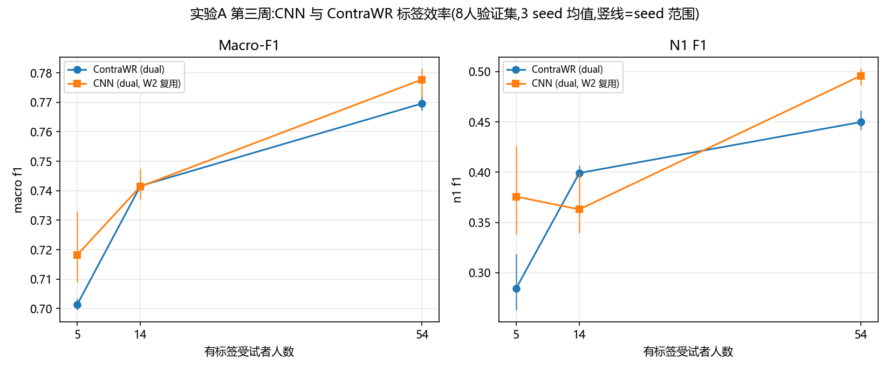

# 实验A 第三周结果:基线比较与标签效率

- 负责人/日期:A / 2026-11-08(第三周工作文档修订版 2026-11-06)
- 指标:8 人开发集(21,186 段),B 官方 `src/evaluation/evaluate.py --reference`;
  配对区间 = 官方 `--compare` 按受试者配对 bootstrap(n=1000,95%)
- 基线:现有 SmallCNN(86,437 参数,W2 run 复用,逐项核查见 [a_w3_reuse_check.md](a_w3_reuse_check.md))
  与新增 ContraWR 监督架构(29,511 参数,上游重实现,选择与适配见
  [a_baseline_selection.md](a_baseline_selection.md))
- 明细:[a_w3_main_grid.csv](a_w3_main_grid.csv)、[a_w3_paired_deltas.csv](a_w3_paired_deltas.csv)、
  [a_w3_eog_contrast.csv](a_w3_eog_contrast.csv)、[a_w3_n1_rem_errors.csv](a_w3_n1_rem_errors.csv)、
  [budget_curves_w3.png](budget_curves_w3.png)、[by_subject/](by_subject/)

## 1. 结论速览

1. **总体:** 同一 dual 输入(Fpz-Cz+EOG)下,ContraWR(29.5k 参数)在 54 人预算
   落后 CNN 约 0.008 Macro-F1(N1 F1 落后 0.042~0.052,3 个 seed 的配对 CI 均不含 0);
   14 人预算两者 Macro-F1 持平(0.7416 vs 0.7415),ContraWR 的 N1 F1 反而高
   +0.036(seed0/2 各 +0.056,CI 含 0);5 人预算 CNN 明显更强(Macro-F1 差
   −0.032~−0.006,N1 F1 差 −0.162~−0.045)。
2. **标签效率:** 从 54 人降到 5 人,两种模型 Macro-F1 退化幅度接近
   (CNN −0.060,ContraWR −0.068),但 N1 F1 退化 CNN −0.120、ContraWR −0.166——
   少标签下 ContraWR 的 N1 退化更明显,5 人预算不宜用 ContraWR。
3. **EOG 贡献(14 人):** dual − eeg 的 Macro-F1 差 +0.019~+0.030(3 个 seed 的
   配对 CI 均不含 0);收益主要来自 REM(+0.077~+0.114 F1)与 N1 精度
   (+0.055~+0.137),代价是 N1 召回(−0.023~−0.164):加入 EOG 后更多真实 N1 被
   判为 W/N2,同时更少把 W/N2 误报成 N1。

## 2. 主矩阵(18 格,3 seed 均值;±为 seed 间标准差)

| 预算 | 方法 | Macro-F1 | N1 F1 | N1 P | N1 R | W F1 | N2 F1 | N3 F1 | REM F1 |
| --- | --- | --- | --- | --- | --- | --- | --- | --- | --- |
| 5 人 | ContraWR | 0.7013 ± 0.0018 | 0.2841 ± 0.0296 | 0.3862 | 0.2270 | 0.895 | 0.846 | 0.809 | 0.672 |
| 5 人 | CNN(复用) | 0.7182 ± 0.0126 | 0.3757 ± 0.0449 | 0.3545 | 0.4107 | 0.881 | 0.824 | 0.849 | 0.662 |
| 14 人 | ContraWR | 0.7416 ± 0.0012 | 0.3991 ± 0.0063 | 0.4328 | 0.3704 | 0.901 | 0.850 | 0.834 | 0.724 |
| 14 人 | CNN(复用) | 0.7415 ± 0.0052 | 0.3630 ± 0.0313 | 0.4588 | 0.3051 | 0.905 | 0.858 | 0.853 | 0.729 |
| 54 人 | ContraWR | 0.7696 ± 0.0023 | 0.4498 ± 0.0098 | 0.5239 | 0.3941 | 0.921 | 0.870 | 0.832 | 0.775 |
| 54 人 | CNN(复用) | 0.7777 ± 0.0051 | 0.4958 ± 0.0081 | 0.4664 | 0.5298 | 0.918 | 0.862 | 0.832 | 0.780 |

(逐 seed 数字与 per-class 数字见 CSV;概率平均等 W2 扩展不在第三周矩阵内。)

## 3. 配对差(ContraWR − CNN,同 budget 同 seed)

| 预算 | seed | ΔMacro-F1 [95% CI] | ΔN1 F1 [95% CI] |
| --- | --- | --- | --- |
| 5 人 | 0 | −0.0315 [−0.0512, −0.0045] | −0.1624 [−0.2436, −0.0417] |
| 5 人 | 1 | −0.0060 [−0.0416, 0.0411] | −0.0448 [−0.1223, 0.0811] |
| 5 人 | 2 | −0.0131 [−0.0392, 0.0171] | −0.0675 [−0.1608, 0.0563] |
| 14 人 | 0 | +0.0032 [−0.0260, 0.0342] | +0.0561 [−0.0332, 0.1517] |
| 14 人 | 1 | −0.0045 [−0.0334, 0.0291] | −0.0021 [−0.0965, 0.0978] |
| 14 人 | 2 | +0.0018 [−0.0175, 0.0260] | +0.0545 [−0.0434, 0.1544] |
| 54 人 | 0 | +0.0001 [−0.0100, 0.0039] | −0.0521 [−0.1105, −0.0261] |
| 54 人 | 1 | −0.0105 [−0.0280, 0.0039] | −0.0442 [−0.0970, −0.0073] |
| 54 人 | 2 | −0.0140 [−0.0317, 0.0018] | −0.0417 [−0.0766, −0.0139] |

- 54 人预算 N1 差异在 3 个 seed 上一致为负且区间不含 0(开发集证据);
  Macro-F1 差异幅度小(≤0.014)。
- 14 人预算下两者无统计差异(区间含 0),N1 方向不统一但 ContraWR 点估计更高。
- 5 人预算 CNN 占优;seed0 的差异最大(该 seed 下 ContraWR N1 F1 0.263)。

## 4. 标签效率曲线与退化

- Macro-F1:5→14→54 人,CNN 0.718→0.742→0.778;ContraWR 0.701→0.742→0.770。
  两者在 14 人相交,54 人与 5 人 CNN 略高。
- N1 F1:CNN 0.376→0.363→0.496(14 人反而低于 5 人,与 W2 观察一致,seed 波动大);
  ContraWR 0.284→0.399→0.450 单调上升。
- 少标签退化:Macro-F1 两者相近(−0.06~−0.07);N1 上 ContraWR 从 54 人降到 5 人
  退化 −0.166,CNN −0.120——ContraWR 少标签 N1 退化更明显。
- 逐人差值见 [by_subject/](by_subject/)(每个比较一份:逐人 Macro-F1 与差)。

## 5. EOG 贡献(14 人,同一 CNN,dual − eeg)

| seed | ΔMacro-F1 [95% CI] | ΔN1 F1 | ΔN1 P | ΔN1 R | ΔREM F1 |
| --- | --- | --- | --- | --- | --- |
| 0 | +0.0193 [0.0090, 0.0459] | −0.0387 | +0.1367 | −0.1636 | +0.0859 |
| 1 | +0.0299 [0.0130, 0.0597] | +0.0146 | +0.0554 | −0.0229 | +0.1137 |
| 2 | +0.0195 [0.0031, 0.0379] | −0.0094 | +0.0548 | −0.0374 | +0.0768 |

- Macro-F1 三个 seed 的配对 CI 均不含 0:加入 EOG 在 14 人预算有稳定正收益。
- N1:精度普遍上升、召回普遍下降(F1 净效应不稳定);REM 稳定提升。
- 错误去向(seed0,见 [a_w3_n1_rem_errors.csv](a_w3_n1_rem_errors.csv)):
  真实 N1 的判类:dual → W 30.4% / N2 35.2% / 正确 27.3%;eeg → W 20.6% /
  N2 24.2% / 正确 43.7%——EOG 让 N1 更常被漏判为 W 或 N2,同时把更多非 N1
  压出 N1(精度↑)。
  真实 REM 的判类:dual 正确 65.0%(eeg 59.3%),REM→N1 由 23.3% 降到 10.1%
  ——EOG 主要帮助 REM 与 N1 的区分。

## 6. 资源与成本(同设备 RTX 4060 Laptop 8GB,同 batch=128)

| 项 | SmallCNN dual | ContraWR dual |
| --- | --- | --- |
| 参数 | 86,437 | 29,511 |
| 推理吞吐(8人验证集,eval+no_grad) | 54,194 epoch/s | 47,141 epoch/s |
| 推理峰值显存 | 27 MiB | 55 MiB |
| 训练峰值显存 | 74 MiB | 130-131 MiB |
| label100 训练总耗时 | 152.3 s | 424-680 s(3 seed) |
| label10 训练总耗时 | 14-22 s | 84-100 s |
| 训练设备/精度/确定性 | cuda / float32 / 种子前置 + cudnn 确定性 | 同左 |

明细:[inference_throughput.csv](inference_throughput.csv)、[resource_profile.csv](resource_profile.csv)。
ContraWR 训练慢约 4.5 倍(每 batch 需 STFT + 2D 卷积),但两者单 run 均 ≤12 分钟,
48 格规模矩阵仍可一天内完成。

## 7. 种子波动与限制

- 种子波动(3 seed):ContraWR Macro-F1 跨 seed 标准差 ≤0.0023(label100),比 CNN
  (0.0051~0.0126)小;N1 F1 的 CNN 波动大(0.031~0.045),ContraWR 5 人预算波动
  0.030。种子波动与按人不确定性分开报告(见 CSV 与配对表 training_seed_summary)。
- 限制:8 人开发集反复使用,区间含 0 不代表等效;所有差异为开发集证据,16 人
  封存测试未动。ContraWR 上游文献口径(Fpz-Cz+Pz-Oz、无 wake trimming、90/5/5
  随机划分、无标准化)与本组不同,文献数字不混入本表(见 a_baseline_selection.md)。
  本组 ContraWR 输入用组内 dual(Fpz-Cz+EOG)代入,输入模态差异已在案。
- ContraWR 上游无 LICENSE 文件:本组仅保留重实现与来源记录,不复制上游代码
  (scripts/contrawr_model.py 头注释)。SleepTransformer 未运行,核查见
  a_baseline_selection.md 第 3 节。
