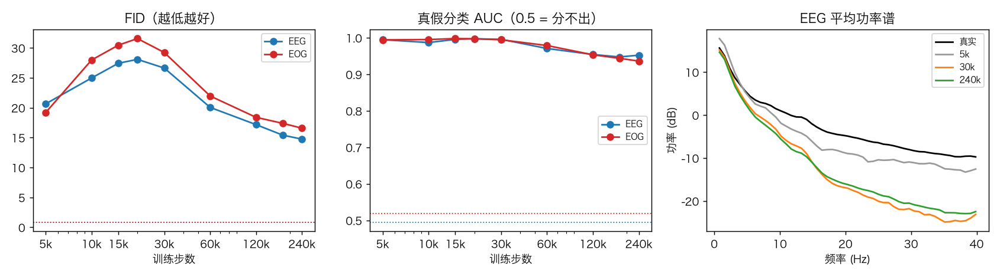

# B 第四周：D 主实验各 checkpoint 的生成质量

对象：D 主实验 `W4_D_main_m64x12_seed0_v01`。checkpoint 来自 Release `d-pretrain-w4-main30k-v01-20261117` 和 `d-pretrain-w4-main240k-v01-20261119`，SHA256 均与 checkpoints.csv 核对一致。
脚本：[scripts/41_b_w4_gen_quality.py](../../scripts/41_b_w4_gen_quality.py)。结果在 [gen_quality/](gen_quality/)。

## 结论

1. **生成质量和 val MSE 的走势不一样。**
   - val MSE 从 5k 到 240k 一直在降。
   - 生成质量先变差，在 20k–30k 最差；之后才持续变好，到 240k 最好。
   - 120k 之后，每多训一段，改善越来越小。
2. **到 240k，生成信号仍然很容易和真实信号区分。** 真假分类 AUC 在 0.94–0.95，而真实数据两半之间是 0.50。FID 为 15–17，真实数据两半之间约 0.9。
3. **主要缺陷是高频不足。** 生成的信号过于平滑，15 Hz 以上的功率比真实信号低 8–14 dB（EEG 和 EOG 都是如此），低频部分基本正确。5k 的指标看起来比 30k 好，是因为 5k 的模型还没把噪声去干净，残留的噪声恰好补上了一部分高频，不代表 5k 的模型更好。
4. **对「训到多少步」的含义**：
   - 生成质量支持「30k 还没训够」。30k 恰好处在生成质量最差的区间，到 240k 还在改善。
   - D 的下游结果是 30k 之后测不出差别。两者合起来看：生成质量好不好，和下游分期特征好不好，不是一回事。
   - 如果正式主模型重视生成能力，用 240k 更合理；只为下游分期，30k 已经够用。



## 结果

每个 checkpoint 生成 EEG、EOG 各 512 条 5 秒信号。真实参照是 8 名 held-out 受试者的 512 条窗（A 半）。「真实 B 半」一行是真实数据自身的抽样波动，也就是最好可能达到的值。

| 步数 | val MSE（stop_metric） | EEG FID | EEG KID | EEG 真假 AUC | EOG FID | EOG KID | EOG 真假 AUC | EEG/EOG 功率谱差（dB） |
| --- | ---: | ---: | ---: | ---: | ---: | ---: | ---: | ---: |
| 真实 B 半 | — | 0.88 | −0.006 | 0.50 | 0.86 | 0.010 | 0.52 | 0.2 / 0.2 |
| 5k | 0.0621 | 20.6 | 0.29 | 0.99 | 19.2 | 0.37 | 0.99 | 3.0 / 3.8 |
| 10k | 0.0573 | 25.0 | 0.53 | 0.99 | 28.0 | 0.69 | 1.00 | 6.8 / 7.3 |
| 15k | 0.0557 | 27.4 | 0.71 | 1.00 | 30.5 | 0.80 | 1.00 | 8.6 / 8.5 |
| 20k | 0.0550 | 28.1 | 0.79 | 1.00 | 31.6 | 0.86 | 1.00 | 9.6 / 9.3 |
| 30k | 0.0539 | 26.6 | 0.80 | 1.00 | 29.2 | 0.83 | 0.99 | 10.0 / 9.3 |
| 60k | 0.0526 | 20.1 | 0.59 | 0.97 | 22.0 | 0.67 | 0.98 | 9.3 / 8.2 |
| 120k | 0.0519 | 17.2 | 0.60 | 0.95 | 18.4 | 0.59 | 0.95 | 9.5 / 7.0 |
| 180k | 0.0516 | 15.4 | 0.58 | 0.95 | 17.4 | 0.57 | 0.94 | 9.5 / 6.9 |
| 240k | 0.0515 | 14.8 | 0.56 | 0.95 | 16.6 | 0.55 | 0.94 | 9.4 / 6.8 |

- KID 的标准差约为 0.02–0.05（10 个子集），各步之间的主要差别大于这个波动。
- val MSE 取自 D 的 val_mse.csv（EMA 权重，不给 EEG 条件）。
- 其他指标见 [gen_quality.csv](gen_quality/gen_quality.csv)：五个频段相对功率的 Wasserstein 距离、幅度分布距离、手工特征的 MMD²。各频段的平均功率谱见 [mean_log_psd.csv](gen_quality/mean_log_psd.csv)。

## 做法

- **生成**：
  - 用 EMA 权重、空条件，按 DDPM 祖先采样走 50 步（与训练的调度相同，v-prediction，不截断）。
  - 9 个 checkpoint 共用同一批初始噪声和逐步噪声，彼此可以直接比较。
  - B 自己写的采样步骤和 diffusers `DDPMScheduler.step` 逐位一致；Mac GPU 与 CPU 前向的最大差约为 2e-5。
- **分布距离**：在 µV 域计算。
  - 平均对数功率谱差：0.5–40 Hz，单位 dB。
  - 五个频段（δ/θ/α/σ/β）相对功率的 Wasserstein 距离。
  - 幅度（log std）的 Wasserstein 距离。
  - 手工特征的 RBF-MMD²。
- **真假分类器**：HistGradientBoosting，特征为对数功率谱加时域统计量，用 5 折分层交叉验证计算 AUC。
- **FID / KID**：
  - 特征取自一个 5 秒窗的睡眠分期 1D CNN（倒数第二层，128 维），EEG 和 EOG 各训练一个。
  - 训练数据只用预训练池 46 人的真实窗，不含 held-out、开发集和测试集。
  - 这个网络只用来评估，不进入任何下游模型。它在 held-out 上的 Macro-F1 约为 0.50，单个 5 秒窗分期本来就难，足够当特征提取器用。

## 局限

- 只有 1 个 backbone seed 和 1 个生成 seed，每组 512 条。FID 在小样本下有偏差，所以只看各步之间的相对变化；KID 是无偏的。
- 生成用的是空条件、5 秒单窗，不评估长时程结构（比如睡眠周期）。

## 复现

```bash
python scripts/41_b_w4_gen_quality.py gen --ckpt-dir <0to30k 目录> <35kto240k 目录> \
    --steps 5000 10000 15000 20000 30000 60000 120000 180000 240000 --device mps
python scripts/41_b_w4_gen_quality.py fidnet
python scripts/41_b_w4_gen_quality.py metrics
```

需要 A 的 NPZ 和 vendor EEGDM。环境：macOS arm64，生成用 MPS，其余用 CPU，torch 2.14.1。测试集未读取。
