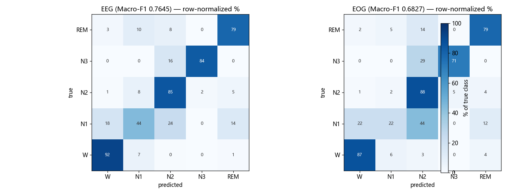
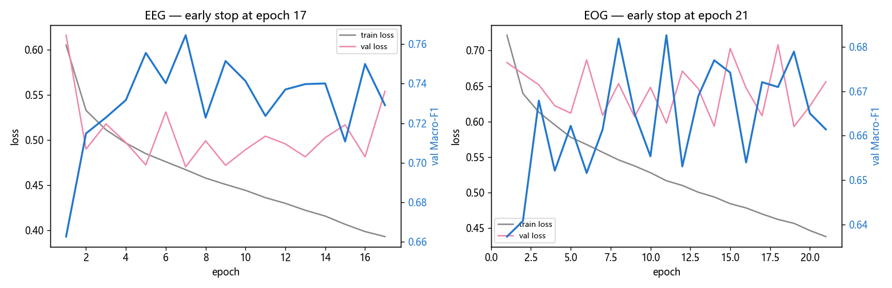

# 实验① 结果报告:数据与单模态基线

负责人:A · 日期:2026-10-18 · 数据:Sleep-EDF Expanded SC(78 人 / 153 晚,100% 标签)

## 一、要回答的问题(对照课题文档)

1. 数据流程可不可信?→ **已跑通并双重审计,可信**
2. 只用 EEG、只用 EOG 各能做到多好?→ **val Macro-F1:EEG 0.7645,EOG 0.6827**
3. N1 有多难?→ **两通道 F1 均 < 0.46,是最弱类;主要被误判为 N2/W/REM**

## 二、数据与流程

- 153 晚全部下载,**逐文件 sha256 校验通过**;78 人按年龄分层划分(种子 42)→ train 54 / val 8 / test 16,[split_subjects.csv](../manifests/split_subjects.csv)已发布(2026-10-18 00:52)
- 预处理:30 s 段,入睡前 30 min ~ 醒来后 30 min,3+4 合并 N3,M/? 剔除,共 **195,469 段**(train 132,938 / val 21,186 / test 41,345)
- 类别分布:W 33.7% / N1 11.0% / N2 35.4% / N3 6.7% / REM 13.2%
- 三个需全组知道的数据发现(详见 [data_checks.md](data_checks.md)):
  1. SC hypnogram 是**变长 R&K 阶段段**(30 s–数小时,24 h),已展开到 30 s 网格;sample_id 用网格序号
  2. mne 读出的信号单位是 V,**×1e6 = µV**
  3. 1 Hz 辅助通道会触发 mne 全量 FFT 重采样(多进程时内存爆炸),须先选通道再加载

## 三、模型与设置

小 CNN(课题文档参考结构,两份完全相同):conv(1→32,k50,s6) → conv(32→64,k8) → conv(64→128,k8) → GAP → FC(128→5)。
Adam lr=1e-3,batch 128,seed 0,归一化统计量仅用训练集,最佳权重按验证集 Macro-F1 选,早停 patience=10。
训练成本:EEG 1.5 min / EOG 2.4 min,GPU 峰值显存 72 MiB(RTX 4060 Laptop)。

## 四、结果(验证集)

| 指标 | EEG (Fpz-Cz) | EOG (horizontal) |
|------|--------------|------------------|
| **Macro-F1(主指标)** | **0.7645** | **0.6827** |
| Accuracy | 0.8182 | 0.7759 |
| F1 – W | 0.9221 | 0.8858 |
| F1 – N1 | 0.4561 | 0.3002 |
| F1 – N2 | 0.8591 | 0.8203 |
| F1 – N3 | 0.8452 | 0.6869 |
| F1 – REM | 0.7399 | 0.7201 |
| N1 精确率 / 召回 | 0.4688 / 0.4441 | 0.4541 / 0.2242 |

## 五、初步现象(先记录,不解释)

1. **N1 是两通道共同的最弱类**。EEG:460 段 N1→W、631→N2、363→REM(漏报为主,精确率与召回都不高);EOG:N1 召回仅 0.224,大半 N1 被吞进 N2
2. **EOG 整体弱于 EEG**(Macro-F1 差 0.082),但在 N1 精确率上几乎打平(0.454 vs 0.469)——EOG 对 N1 的"乱报"并不比 EEG 多,是"漏报"更严重
3. N3 在 EOG 上明显更弱(0.687 vs 0.845),EOG 的 N3 主要混入 N2(315/1101 段)——慢波在眼电上不可见,符合直觉
4. EEG 的 W/N2/N3 都已 >0.84,N1 和 REM(0.74)是短板

## 六、运行记录

| run | 文件夹 | best epoch | 耗时 | 峰值显存 |
|-----|--------|-----------|------|---------|
| EEG | [E1_EEG_label100_seed0_v01](../runs/E1_EEG_label100_seed0_v01/) | 7 | 1.46 min | 72 MiB |
| EOG | [E1_EOG_label100_seed0_v01](../runs/E1_EOG_label100_seed0_v01/) | 11 | 2.4 min | 72 MiB |

每个运行文件夹含 README.md / config.yaml / history.csv / best.ckpt / metrics.json / predictions_val.csv。
两模型的验证集预测表 sample_id 集合与 y_true **完全对齐**(各 21,186 行),D 可直接做融合与翻转统计。

## 七、交付物与交接状态

| 交接点 | 交付物 | 状态 |
|--------|--------|------|
| ① 划分文件(给 B/C/D) | split_subjects.csv | ✅ 已发布 |
| ③ 预处理数据 + 训练脚本(给 B) | data/processed/*.npz + scripts/05_train_cnn.py | ✅ 就绪 |
| ⑤ 验证集逐段预测(给 D) | 两个 predictions_val.csv | ✅ 就绪 |

## 八、遗留与注意

- `scripts/evaluate.py` 是临时版;**B 的官方 evaluate.py 交付后,本报告分数需用官方脚本重算**再对外引用
- 测试集(16 人 / 41,345 段)全程未碰,等全组方法定稿后评估一次
- 流程复查:两轮独立审查工作流(63 个代理)审计了脚本与交付物,发现的全部问题已修复并记录

## 附:回答课题文档"本周要搞清楚的三件事"

1. 流程能不能跑通 → **能**(下载→划分→预处理→训练→评估→预测表全链跑通,含过拟合检查与对齐检查)
2. EEGDM 能不能用于睡眠数据 → 本实验不涉及,等 C 的结果与本文基线对比
3. 初步现象 → 见第五节;N1 漏报+误判、EOG 的 N1 精确率打平,是最值得带到复盘会的两个现象
